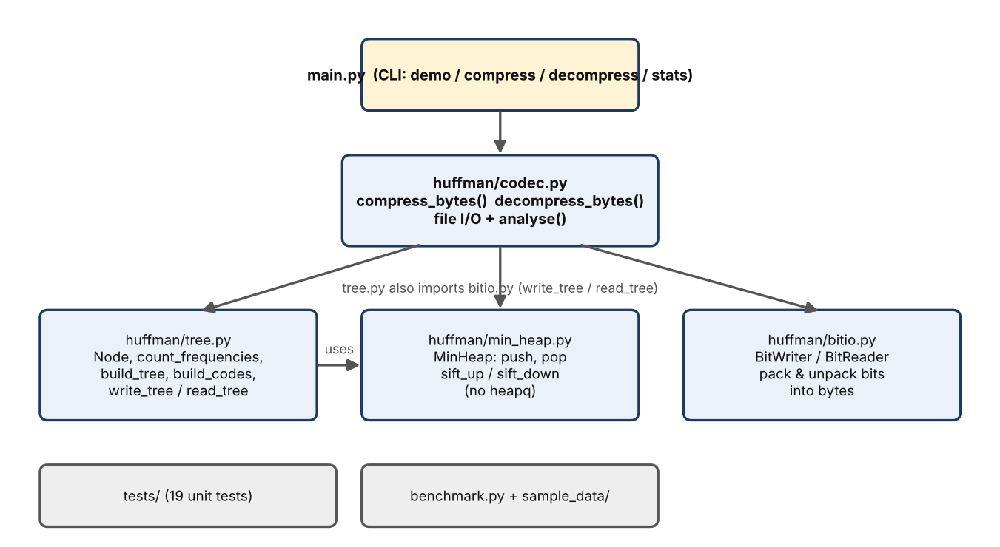
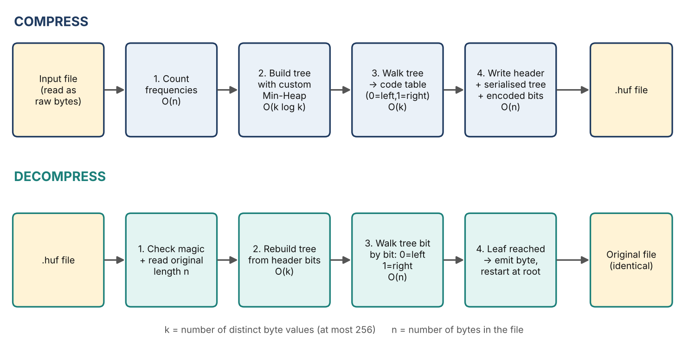

# Text File Compression - Huffman Coding (custom Min-Heap)

Reference reconstruction used for interview preparation. Pure Python, standard library only.

**Honesty note:** this is a *reconstruction* of the project described on the CV, not the original code. All XML/JSON/text sample files are **synthetic** (generated by `generate_sample_data.py`); `project_source.py.txt` is this project's own source. Benchmark numbers describe these files only.

## Run
```
python main.py demo                       # start here (2-minute demo)
python main.py compress  sample_data/users.json out.huf
python main.py decompress out.huf restored.json
python main.py stats sample_data/catalog.xml
python benchmark.py                       # writes sample_output/benchmark_results.md
python -m unittest discover -s tests -v   # 19 tests
python generate_sample_data.py            # re-create sample_data/
```

## How it works
1. Count byte frequencies - O(n)
2. Build the Huffman tree with a custom binary **MinHeap** - O(k log k), k = distinct bytes (<= 256)
3. Walk the tree to get codes (left = 0, right = 1) - O(k)
4. Write header (`HUF1`, original length), the serialised tree, then the encoded bits - O(n)
5. Decompress: rebuild tree from the header in one pass - O(k); walk the tree bit by bit - O(n)




## Layout
```
main.py                  CLI entry point
huffman/min_heap.py      custom binary min-heap
huffman/tree.py          Node, frequency count, build_tree, codes, tree (de)serialisation
huffman/bitio.py         BitWriter / BitReader
huffman/codec.py         compress_bytes / decompress_bytes / file I/O / analyse
benchmark.py             benchmark + SHA-256 lossless check
tests/                   unit tests (empty, 1 byte, 1 symbol, all 256 bytes, binary, unicode, corrupt files ...)
sample_data/  sample_output/  docs/
```

## Known limitations
Byte-level (order-0) model only; whole file in memory; tiny files can grow (header cost); decoding is bit-by-bit in Python (slow vs C); weaker than gzip/zstd which add LZ77 matching.
